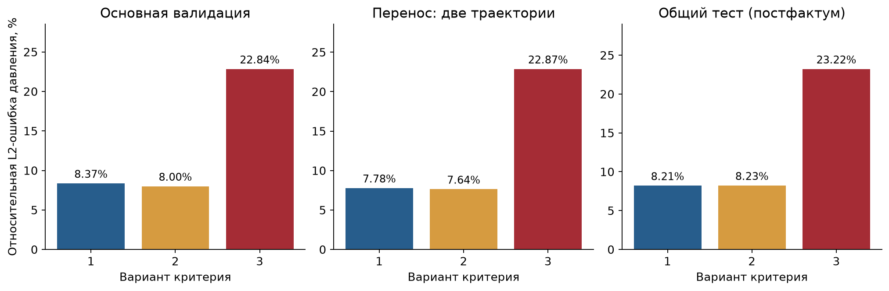
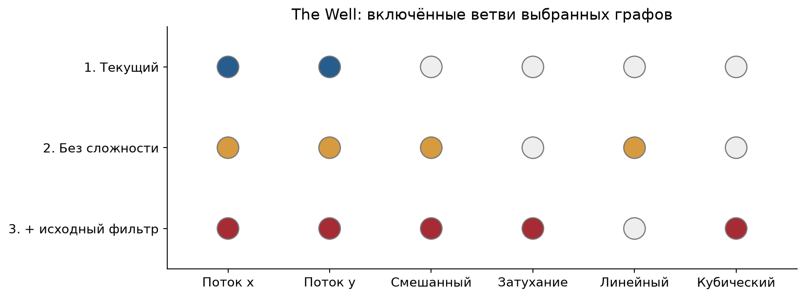

# Лабораторная № 3: влияние критерия выбора графа

Сравниваем три настройки на одном семействе из 64 уравнений. Основной результат — The Well; точная аналитика и аналитика с 1% шума приведены отдельно.

## Что меняется

Обозначим $Q(G)=E_p(G)+0.1E_m(G)+0.5E_{int}(G)$. Во всех вариантах
$E_{int}$ — ошибка на двух отдельных траекториях версии 3.

| Вариант | Целевая функция | Дополнительный статистический фильтр |
|---|---|---|
| 1. Текущий | $J_1=Q+0.02N+0.01B$ | Нет |
| 2. Без сложности | $J_2=Q+0.01B$ | Нет |
| 3. Без сложности + исходный фильтр | $J_3=Q+0.01B$ | Требует сохранить все ветви с меткой «не удалять» |

В варианте 3 для любого допущенного графа $B=0$, поскольку он содержит все
требуемые ветви. Это тот же первоначальный алгоритм фильтрации, применённый
к текущим bootstrap-оценкам. Старые данные и прежний E_int не возвращаются.

Сложность N — число включённых ветвей графа, а не число коэффициентов,
статистически отличимых от нуля. Вариант 2 сохраняет мягкую диагностику B:
удаляется только штраф за число ветвей. Значения разных J напрямую не сравниваем;
сравниваем одинаковые ошибки решений.

## Что фиксировано

- Обучение, основная валидация, две траектории переноса и общая тестовая траектория.
- Коэффициенты каждого из 64 кандидатов, оценённые только на обучении.
- Общая нормировка P0 по обучению, сетка, солвер и точность интегрирования.
- Математические ограничения, устойчивость и предел основной валидационной ошибки 50%.
- Остальные веса: 1 для давления, 0.1 для моментов, 0.5 для переноса, 0.01 для B.
- По 3 раунда × 5000 предложений: одинаковые маски, U и температуры во всех трёх вариантах.

Температуры взяты из базового варианта версии 3 и зафиксированы для сравнения.
Это исключает влияние разной адаптации температуры. Минимум каждого критерия
проверяется перебором; дополнительно повторены 10 seed сэмплера.
Никакого предпочтения меньшего N при точном равенстве J в этом сравнении нет:
равенства разрешаются по номеру маски.

## The Well: три результата

| Вариант | Маска | Ветвей | Допущено графов | Валидация | Перенос E_int | Общий тест |
|---|---:|---:|---:|---:|---:|---:|
| 1. Текущий | 3 | 2 | 16 | 8.37% | 7.78% | 8.21% |
| 2. Без сложности | 23 | 4 | 16 | 8.00% | 7.64% | 8.23% |
| 3. Без сложности + фильтр | 47 | 5 | 8 | 22.84% | 22.87% | 23.22% |



### Какие члены выбраны

| Вариант | Включённые члены |
|---|---|
| 1. Текущий | поток x, поток y |
| 2. Без сложности | поток x, поток y, смешанный поток, линейный возвращающий член |
| 3. Без сложности + фильтр | поток x, поток y, смешанный поток, затухание, кубический член |



### Подобранные коэффициенты

| Вариант | θ1 | θ2 | θ3 | θ4 | θ5 | θ6 |
|---|---:|---:|---:|---:|---:|---:|
| 1. Текущий | 1.002944 | 1.002961 | 0 | 0 | 0 | 0 |
| 2. Без сложности | 1.00285 | 1.002886 | 0.0007367086 | 0 | 0.1141461 | 0 |
| 3. Без сложности + фильтр | 1.003074 | 1.003181 | 0.0006133542 | 0.5094625 | 0 | 3.869705 |

Здесь θ1/θ2 умножают потоки по x/y; θ3 — смешанный поток; θ4 — -p_t/T0;
θ5 — -p/T0²; θ6 — -p³/(P0²T0²). P0 один и тот же во всех вариантах.

## Почему исходный фильтр меняет результат

На The Well диагностика требует ветви: поток x, поток y, затухание.

Исходное правило разрешает удалить ветвь, только если во всех вариантах
блока 4/8/12 одновременно выполнены условия: 95%-й интервал содержит ноль,
верхняя граница прироста ошибки моментов при refit не выше 0.01,
W1/SD0 при возмущении остатков не выше 1.

В варианте 3 графы без затухания получают нулевую вероятность принятия.
Так исключаются и маска 3 из варианта 1, и маска 23 из варианта 2, независимо
от их меньшей ошибки давления. Среди оставшихся восьми допустимых графов
выбирается маска 47. Фильтр требует присутствие, но не ограничивает число
дополнительных ветвей: без штрафа за N они могут сохраняться.

## Аналитический benchmark

Ошибки в следующих таблицах — относительные L2 в долях, не проценты.

### Без шума

| Вариант | Маска | Ветвей | Допущено графов | Валидация | Перенос E_int | Общий тест |
|---|---:|---:|---:|---:|---:|---:|
| 1. Текущий | 3 | 2 | 16 | 6.686e-10 | 2.343e-10 | 3.317e-10 |
| 2. Без сложности | 43 | 4 | 16 | 6.686e-10 | 2.343e-10 | 3.317e-10 |
| 3. Без сложности + фильтр | 43 | 4 | 16 | 6.686e-10 | 2.343e-10 | 3.317e-10 |

Варианты 2/3 формально выбирают маску 43 с четырьмя ветвями, но добавочные
коэффициенты затухания и кубического члена имеют величину порядка 1e-16 и 1e-14.
Разница ошибок между такими графами находится на уровне численной арифметики.
Это практически одно и то же уравнение; лишние вершины не доказывают новую физику.
Критерий без сложности не обязан удалить ветвь с практически нулевым вкладом.

### С 1% шума в обучающем p_tt

| Вариант | Маска | Ветвей | Допущено графов | Валидация | Перенос E_int | Общий тест |
|---|---:|---:|---:|---:|---:|---:|
| 1. Текущий | 3 | 2 | 16 | 1.639e-04 | 1.150e-04 | 1.300e-04 |
| 2. Без сложности | 7 | 3 | 16 | 2.789e-04 | 1.769e-04 | 2.133e-04 |
| 3. Без сложности + фильтр | 7 | 3 | 8 | 2.789e-04 | 1.769e-04 | 2.133e-04 |

Диагностика требует ветви: поток x, поток y, смешанный поток.

Мягкий B тоже влияет на выбор: в варианте 2 это не только соревнование
ошибок давления. Поэтому меньшая ошибка давления у маски 3 сама по себе
не гарантирует ей лучший J. В варианте 3 смешанный поток становится обязательным.

## Как интерпретировать сравнение

1. На The Well штраф за N выбирает более простую модель, хотя её ошибки
   основной валидации и переноса немного выше. Это предпочтение простоты.
2. Без штрафа выбираются четыре ветви. Ошибки на общей тестовой траектории
   первых двух вариантов почти одинаковы: разница порядка 0.02 процентного пункта.
   По одной траектории нельзя объявлять это статистически значимым преимуществом.
3. Жёсткий фильтр исключает лучшие по давлению кандидаты из-за требования
   сохранить затухание. В данном опыте он заметно ухудшает воспроизведение давления.
4. Точная аналитика показывает неединственность записи: несколько графов
   с почти нулевыми добавочными коэффициентами практически эквивалентны.
5. Это демонстрация чувствительности отбора к критерию, а не доказательство,
   что один вариант универсально лучше остальных.

## Статус теста и ограничения

Для всех вариантов используется одна и та же The Well test/sample_2 и
аналитическая реализация seed 55002. Они уже просматривались в предыдущем опыте:
нынешнее сравнение постфактум, а не новый слепой тест. В выборе графов эти
кадры не используются, коэффициенты не переподбираются, веса не настраиваются.
Основные сопоставимые результаты отбора — общая валидация и перенос.

Данные вычислительные, 2D + время. Две траектории переноса и один общий тест
не обеспечивают надёжной оценки обобщения на всё семейство лабиринтов.
Повторы seed характеризуют случайность сэмплера, а не неопределённость данных.

## Воспроизведение

```sh
python -m lab03.criterion_comparison
```

Нужны готовые каталоги версии 3 и отдельное окружение .clawpack для новых
прямых расчётов. После первого запуска сохранённые тестовые решения используются
повторно. JSON-отчёт, каталоги, графы/матрицы и журналы всех предложений:
[results/criterion_comparison/](results/criterion_comparison/).
