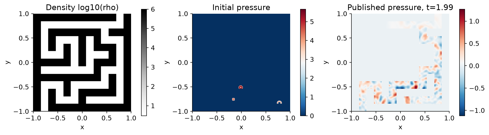

# Лабораторная № 3 — сессия работы с Codex

**Тема:** The Well: acoustic scattering maze. **Метод № 4:** семплирование с отклонением (rejection sampling).

**Период:** 12.11.2026–14.11.2026. Время сообщений — московское (UTC+3).

Всего сообщений: 91. Сообщений пользователя: 27;
промежуточных обновлений Codex: 42; полных ответов Codex: 22.

Сессия начинается с первого запроса о лабораторной № 3, включает планирование,
выбор данных, выполнение, исправления критерия, обсуждение интервенций,
сравнение трёх вариантов отбора и перестройку презентации. Заканчивается
просьбой загрузить обновлённые презентацию, ноутбук и переписку в GitHub включительно.

Первые 48 сообщений предыдущего экспорта сохранены; продолжение начинается
с сообщения № 49.

Текст сообщений сохранён; формулы и ссылки на локальные материалы адаптированы
для GitHub. Вызовы инструментов, их выводы, внутренние рассуждения и технический
контекст интерфейса не включены. Короткие незавершённые сообщения пользователя
сохранены в исходном порядке.

Первоначальные результаты в начале переписки относятся к версии критерия № 1;
после сообщения «Поправь критерий» приведён пересчёт версии № 2. Далее
обсуждается версия № 3 с отдельными траекториями переноса и сравнение трёх
критериев: [подробный отчёт](criterion_comparison_report.md). Актуальные
результаты — в [README](README.md), [ноутбуке](lab03_acoustic_scattering.ipynb)
и [презентации](presentation.pdf). Старая реализация фильтра сохранена в
[criterion_v1](results/criterion_v1/) и [criterion_v2](results/criterion_v2/).

---

## 01. Пользователь · 12.11.2026 01:18:19

Прикреплённый файл: [Лабораторная работа № 3.pdf](../docs/references/lab03_requirements.pdf).

Нужно сделать лабораторную номер 3 для темы 10. The Well: acoustic scattering maze. Составь план выполнения

---

## 02. Codex — ход работы · 12.11.2026 01:18:22

Прочитаю задание и составлю план для The Well: acoustic scattering maze: от выбора данных и модели до экспериментов и отчёта. Для чтения PDF использую навык `pdf`.

---

## 03. Codex — ход работы · 12.11.2026 01:19:06

В задании главное — семплировать графы и выбирать структуру по точности, сложности и устойчивости к интервенциям. У The Well есть нужные поля, но это результаты численного моделирования, а не физические измерения; в плане отмечу это ограничение и учту перенос критерия из второй лабораторной на новую тему.

---

## 04. Codex · 12.11.2026 01:21:01

Предлагаю построить работу вокруг задачи: **по данным о распространении звука в лабиринте выбрать граф уравнений, который точно описывает динамику, содержит минимум лишних связей и сохраняет качество при интервенциях**.

План учитывает требования задания: генерацию последовательности графов, оценку отдельных элементов, использование интервенций при поиске, сохранение выборки, визуализации, презентацию и доклад. [Лабораторная работа № 3.pdf](../docs/references/lab03_requirements.pdf)

**1. Зафиксировать уравнение и исследовательский вопрос**

Для выбранной темы используем систему акустики с переменными коэффициентами:

```math
\begin{aligned}
\frac{\partial p}{\partial t}
&=-K(x,y)\left(\frac{\partial u}{\partial x}+
\frac{\partial v}{\partial y}\right),\\
\frac{\partial u}{\partial t}
&=-\frac{1}{\rho(x,y)}\frac{\partial p}{\partial x},\\
\frac{\partial v}{\partial t}
&=-\frac{1}{\rho(x,y)}\frac{\partial p}{\partial y}.
\end{aligned}
```

Здесь $p$ — давление, $u,v$ — компоненты скорости, $\rho$ — плотность среды, $K$ — модуль объёмной упругости. Лабиринт задаётся пространственным распределением свойств среды. Это исходная система из [описания датасета](https://polymathic-ai.org/the_well/datasets/acoustic_scattering_maze/).

Исследовательский вопрос: **сможет ли поиск восстановить необходимые взаимодействия давления и скорости, удалив добавленные лишние ветви?**

**2. Подготовить данные**

Используем опубликованный [архив acoustic_scattering_maze](https://huggingface.co/datasets/polymathic-ai/acoustic_scattering_maze): поля давления, скорости и характеристики среды. Данные двумерные по пространству и зависят от времени.

Начнём с небольшой подвыборки разных лабиринтов. Разделим её на обучение, валидацию и окончательный тест **по целым траекториям**, чтобы соседние кадры одной реализации не попадали в разные части.

Проверим координаты, временную сетку, начальные и граничные условия непосредственно в файлах. Построим карту лабиринта и несколько кадров распространения волны.

Важное ограничение: **The Well содержит численные симуляции, а не физические измерения**. Если требование «реальные данные» означает именно экспериментальные измерения, этот пункт потребует отдельного источника или согласования использования The Well.

**3. Построить исходный граф и пространство кандидатов**

Подготовим расширенную модель, содержащую:

- исходные акустические взаимодействия;
- дополнительные проверяемые ветви: например, затухание и лишние перекрёстные связи;
- коэффициенты, которые подбираются для каждой структуры.

Все дополнительные члены приведём к согласованным физическим размерностям. Удаление ветви будет означать исключение конкретного слагаемого с последующим подбором остальных коэффициентов.

Представление сделаем на двух уровнях:

- **дерево выражений** — для понятного изображения формул;
- **граф перехода между моментами времени** — для интервенций и интерпретации динамических зависимостей.

Давление и скорость влияют друг на друга во времени. Поэтому DAG построим с временными слоями: зависимости направлены от текущего состояния к следующему. Само дерево формулы ещё не доказывает причинность её связей.

Для хранения графов предлагаю **NetworkX**, для выражений — **SymPy**. Для каждого кандидата сохраним также матрицу смежности и соответствующую систему уравнений.

**4. Адаптировать критерий из лабораторной № 2**

Перенесём уже реализованный принцип: ветвь можно удалить, если одновременно:

- её вклад статистически совместим с нулём;
- после удаления и повторного подбора параметров ошибка существенно не возрастает;
- решение об удалении устойчиво к возмущениям данных;
- вывод сохраняется при изменении настроек блочного bootstrap.

Численные допуски из микроволновой задачи автоматически переносить нельзя. Для акустики зададим нормировку ошибок и зафиксируем допуски до основного поиска.

Для bootstrap будем перевыбирать целые траектории или пространственно-временные блоки, сохраняя зависимости внутри данных.

**5. Подготовить численный расчёт и подбор параметров**

Для исходной системы предлагаю использовать **Clawpack/PyClaw с решателем акустики в неоднородной среде**. В официальной документации есть [пример для этой системы](https://www.clawpack.org/gallery/pyclaw/gallery/acoustics_2d_interface.html).

До поиска графов проверим расчёт на простых задачах: распространении волны в однородной среде и отражении от границы двух материалов. Оценим чувствительность к сетке и шагу времени.

Для каждого графа будем:

1. Подбирать коэффициенты на обучающих данных.
2. Численно интегрировать полученную систему.
3. Сравнивать рассчитанные поля с валидационными данными.

Чтобы поиск был выполнимым, сначала используем дешёвую оценку локальной динамики, затем проверим лучшие структуры полноценным расчётом траекторий. Приближение производных возле границ материалов проверим отдельно.

**6. Задать интервенции и целевую функцию**

Разделим две проверки:

| Проверка | Что меняем | Что оцениваем |
|---|---|---|
| Устойчивость к ошибкам наблюдения | Шум в наблюдаемых полях | Стабильность параметров и выбранных ветвей |
| Физическая интервенция | Начальное давление, положение источника или свойства среды | Способность модели воспроизвести изменённую динамику |

Для физической интервенции потребуется заново рассчитать эталонное течение волны. Простого изменения чисел в сохранённых кадрах недостаточно.

Предлагаю минимизировать:

```math
J(G)=E_{\mathrm{val}}(G)
+\lambda_C C(G)
+\lambda_I E_{\mathrm{int}}(G),
```

где $E_{\mathrm{val}}$ — нормированная ошибка полей на валидации, $C(G)$ — сложность графа, $E_{\mathrm{int}}$ — ошибка на заранее заданных интервенциях.

Ошибки давления и скорости нормируем отдельно. Веса зафиксируем по обучению и валидации; окончательный тест оставим для итоговой оценки.

**7. Реализовать генерацию графов: Greedy hill climbing и Tabu search**

Предлагаю выбрать **пункт 10 списка методов — Greedy hill climbing и Tabu search**. Сравним обычный жадный поиск с поиском, использующим память недавних изменений. Основной источник — [Glover, *Tabu Search — Part I*](https://doi.org/10.1287/ijoc.1.3.190).

Один шаг алгоритма:

1. Сгенерировать соседние графы добавлением, удалением или заменой допустимой ветви.
2. Проверить корректность структуры и уравнений.
3. Подобрать параметры и вычислить целевую функцию, включая интервенции.
4. Выбрать следующий граф с учётом tabu-запретов.
5. Сохранить кандидатов, оценки и причину перехода.

Tabu search сможет временно переходить к худшему решению, чтобы выходить из локальных минимумов. Исключение из запрета разрешим для нового лучшего результата.

Так результаты интервенций будут влиять **на следующий шаг поиска**. Сохранённая выборка будет историей поискового алгоритма; её не будем выдавать за выборку из байесовского распределения.

**8. Провести сравнительный эксперимент и обосновать алгоритм**

Сравним при одинаковом вычислительном бюджете:

- исходную физическую модель;
- расширенную модель без удаления ветвей;
- случайную генерацию допустимых графов;
- Greedy hill climbing;
- Tabu search.

Повторим поиск с несколькими начальными графами и случайными seed. Отдельно проверим, что меняется при исключении интервенционной части критерия.

В обосновании покажем сохранение ацикличности, допустимость преобразований и условия остановки. На небольшом пространстве графов сравним результат с полным перебором. Для основной задачи не будем заявлять гарантию глобального оптимума.

**9. Подготовить результаты и материалы для защиты**

В ноутбуке покажем:

- последовательность графов с выделенными изменениями;
- ошибку и сложность по шагам поиска;
- данные, решение выбранной модели и карту их разности;
- временные сигналы в нескольких точках лабиринта;
- результаты интервенций;
- устойчивость выбора ветвей между запусками;
- итоговое дерево и матрицу смежности.

Работу организуем в отдельной директории `lab03/`: переиспользуемые модули, выполненный ноутбук, конфигурации, сохранённые графы, результаты, источники и инструкции запуска. Дополнительно подготовим краткую презентацию и текст доклада.

**Критерий завершения:** получен выбранный граф с явно записанными уравнениями, сохранена история поиска, измерено качество на отложенных траекториях и интервенциях, а решение о сохранении каждой существенной ветви можно объяснить.

---

## 05. Пользователь · 12.11.2026 01:23:27

Кстати, забыл написать, что мне достался метод номер 4 из методов сэмплирования

---

## 06. Codex · 12.11.2026 01:24:12

Тогда используем **метод № 4 — семплирование с отклонением (rejection sampling)**. Исправляем пункты 7–8 плана; уравнение, данные, интервенции и критерий оценки остаются прежними.

**7. Генерация графов с отклонением**

Сначала зададим конечное пространство допустимых графов: исходные акустические взаимодействия и дополнительные проверяемые ветви. Генератор будет случайно выбирать, какие ветви включить.

Для каждого кандидата $G$:

1. Проверяем допустимость структуры и математическую корректность уравнений.
2. Подбираем параметры на обучающих данных.
3. Оцениваем точность, сложность и поведение при интервенциях:
   ```math
   J(G)=E_{\mathrm{val}}(G)+\lambda_C C(G)+\lambda_I E_{\mathrm{int}}(G).
   ```
4. Принимаем граф, если он проходит критерии сохранения элементов из лабораторной № 2 и удовлетворяет условию
   ```math
   J(G)\leq\varepsilon.
   ```
5. Сохраняем кандидат, его параметры, оценки и причину принятия или отклонения.

При фиксированном пороге это даёт выборку из исходного распределения генератора, условную на прохождение фильтра:

```math
p_\varepsilon(G)=
\frac{q(G)\,\mathbf{1}\{G\text{ проходит фильтр}\}}
{\sum_H q(H)\,\mathbf{1}\{H\text{ проходит фильтр}\}}.
```

Здесь $q(G)$ — известное распределение генерации кандидатов.

**Как использовать результаты для следующего шага семплирования**

Организуем поиск в несколько раундов. После первого раунда проанализируем оценки принятых графов и установим более строгий порог для следующего раунда, например по квантилю полученных значений $J$.

Внутри каждого раунда порог и правила оценки фиксированы. Выборки разных раундов будем хранить отдельно, поскольку они соответствуют разным условиям отбора. Так выполним требование задания об использовании результатов предыдущего семплирования.

**8. Проверка метода и сравнительный эксперимент**

Сравним:

- случайную генерацию без отбора;
- семплирование с отклонением по точности и сложности;
- полный критерий, включающий интервенции;
- исходную физическую модель.

Измерим качество выбранного графа, сложность, долю принятых кандидатов, вычислительные затраты и устойчивость результата между запусками.

На небольшом пространстве графов проведём полный перебор: проверим, какие структуры проходят фильтр и соответствует ли им полученная выборка. Также зададим предельное число попыток: слишком строгий порог может привести к практически полному отклонению кандидатов.

В визуализациях покажем **последовательность предложенных графов с отметками «принят / отклонён»**, изменение порога между раундами и итоговую аппроксимацию данных выбранной системой уравнений.

---

## 07. Пользователь · 12.11.2026 01:25:44

Давай найдем реальные 3-х мерные данные, если такие существуют

---

## 08. Codex — ход работы · 12.11.2026 01:25:48

Проверю, есть ли открытые экспериментальные данные с тремя пространственными координатами для акустического рассеяния. Отдельно посмотрю, содержат ли они поле во времени или только измерения на поверхности: это определяет, сможем ли мы использовать их в нашей постановке.

---

## 09. Codex — ход работы · 12.11.2026 01:26:38

Нашёл несколько подходящих архивов. Самый перспективный содержит измеренные импульсные отклики на объёмной сетке $48\times51\times26$, то есть три пространственные координаты и время. Это акустика комнаты, а не лабиринта; проверяю состав данных и ограничения — в частности, измеряли ли авторы только давление или ещё и скорость.

---

## 10. Codex · 12.11.2026 01:27:19

**Да, нашёл открытые экспериментальные данные с тремя пространственными координатами и временем.** Наиболее подходящий вариант — **3D Meshgrid Room Impulse Response Dataset**. Это измерения распространения звука в комнате. Открытого экспериментального аналога именно лабиринта The Well я пока не нашёл.

**1. 3D Meshgrid — рекомендую для нашей работы**

Авторы, Yoichi Haneda и Yi Ren, измеряли отклик комнаты на известный звуковой сигнал, перемещая микрофонную систему по объёмной сетке:

- $48\times51\times26=63\,648$ пространственных точек;
- шаг **2 см по каждой координате**;
- четыре положения громкоговорителя;
- в каждой точке записан временной импульсный отклик.

Таким образом, данные можно представить как $h(x,y,z,t)$. Импульсный отклик показывает, как в данной точке приходят прямой звук и последующие отражения. Постановка и структура файлов описаны на [странице авторов](https://yh-audio.github.io/meshgrid-ir.html).

Доступны две версии:

| Версия | Временная запись | Объём | Ссылка |
|---|---|---|---|
| Обработанная: подавлены отражения от измерительной конструкции | 16 кГц, 0,25 с | Около 1 ГБ на положение источника | [Архив Part 1](https://zenodo.org/records/17051811) |
| До подавления отражений от конструкции | 48 кГц, 0,1 с | Около 1,2 ГБ на положение источника | [Архив Part 0](https://zenodo.org/records/19656813) |

Связанная публикация — **“3D Mesh Grid Room Impulse Responses Measured with a Linear Microphone Array and Suppression of Frame Reflections”**, IEEE ICASSP 2026. [Статья по DOI](https://doi.org/10.1109/ICASSP55912.2026.11461569).

**2. MeshRIR — более компактная пространственная сетка**

Нужна именно часть **S1-M3969**:

- объём $1\times1\times0{,}4$ м;
- сетка $21\times21\times9$, шаг 5 см;
- один источник;
- частота записи 48 кГц, 32 768 отсчётов на точку.

Это реальные измерения микрофоном на роботизированной установке. [Описание авторов](https://www.sh01.org/MeshRIR/), [архив — около 996 МБ для версии NumPy](https://zenodo.org/records/10852693), [статья IEEE WASPAA 2021](https://arxiv.org/abs/2106.10801).

**3. MP-RIR — больше вариантов источника**

Архив Fraunhofer содержит **68 736 измеренных импульсных откликов**, 8 592 пространственные позиции микрофонов и восемь положений источников. Приложены координаты, параметры установки и геометрия комнаты. Полный объём — 27,5 ГБ, отдельное положение источника — около 3,4 ГБ. [Архив и документация MP-RIR](https://zenodo.org/records/11148712).

Для лабораторной я бы выбрал **первый вариант**: регулярная объёмная сетка удобнее для пространственных производных, а разные положения источника дают возможность проверять перенос модели на другое возбуждение.

При этом постановку нужно уточнить: эти архивы содержат **акустические отклики давления, без измеренного полного вектора скорости**. Поэтому практически разумнее исследовать граф **скалярного волнового уравнения**, которое следует из системы акустики. В однородном воздухе, внутри области без источника:

```math
\frac{\partial^2 p}{\partial t^2}
=
c^2\left(
\frac{\partial^2p}{\partial x^2}
+\frac{\partial^2p}{\partial y^2}
+\frac{\partial^2p}{\partial z^2}
\right).
```

Это позволяет сохранить физическую основу задачи и метод № 4 — семплирование графов с отклонением. **Восстановление пространственно переменной плотности стен лабиринта по этим данным заявлять нельзя**; исследовать будем структуру распространения звука в измеренном объёме.

---

## 11. Пользователь · 12.11.2026 01:28:23

А в чем отличие от The Well?

---

## 12. Codex · 12.11.2026 01:28:55

Главное отличие: **The Well даёт полное состояние численно смоделированной волны в лабиринте, а предложенный архив — измеренные звуковые отклики внутри настоящей комнаты.** Физическая основа близкая, но исследовательская задача изменится.

| Характеристика | The Well: acoustic scattering maze | 3D Meshgrid |
|---|---|---|
| Происхождение | Численное моделирование | Физические измерения |
| Пространство | Две координаты: $x,y$ | Три координаты: $x,y,z$ |
| Среда | Лабиринт с резкими перепадами плотности | Комната с отражающими поверхностями |
| Данные | Давление, две компоненты скорости, свойства среды | Импульсные отклики и координаты измерений |
| Разнообразие | Много лабиринтов и начальных условий | Одна комната, четыре положения источника |

Состав данных подтверждён в описаниях [The Well](https://polymathic-ai.org/the_well/datasets/acoustic_scattering_maze/) и [3D Meshgrid](https://yh-audio.github.io/meshgrid-ir.html).

**Различается способ задания препятствий.** В The Well лабиринт включён в уравнение через известную плотность $\rho(x,y)$: в стенах и проходах она сильно различается. Поэтому можно непосредственно исследовать, как свойства среды влияют на давление и скорость.

Для измеренного объёма внутри комнаты разумное первое приближение — однородный воздух. Стены влияют на поле через отражения и граничные условия. Сам измеренный объём не содержит полной карты материалов комнаты.

**Импульсный отклик тоже имеет физический смысл поля во времени.** $h(x,y,z,t)$ описывает ответ в каждой точке на короткое возбуждение источника. Через него можно получить отклик на произвольный сигнал $s(t)$:

```math
p(x,y,z,t)=\int h(x,y,z,\tau)\,s(t-\tau)\,d\tau,
```

с учётом калибровки измерительного тракта. Поэтому эти данные подходят для исследования волнового уравнения, хотя непосредственно скорости частиц воздуха в них нет.

Для нашей лабораторной последствия такие:

- **С The Well** исследуем граф системы акустики в неоднородном лабиринте, имея доступ ко всем её основным полям.
- **С 3D Meshgrid** исследуем граф уравнения давления по экспериментальным данным в трёхмерном объёме. Придётся учитывать шум, ограниченную область измерений и неизвестные граничные условия.
- **Семплирование с отклонением применимо в обоих случаях**, но экспериментальные данные не гарантируют, что все конкурирующие структуры удастся различить.

То есть 3D Meshgrid подходит как **экспериментальная задача по трёхмерной акустике**, однако это будет адаптация темы, а не воспроизведение именно лабиринта The Well.

---

## 13. Пользователь · 12.11.2026 01:30:51

Нет нужно именно The Well: acousting scattering maze

---

## 14. Codex — ход работы · 12.11.2026 01:30:58

Понял, сохраняем именно **The Well: acoustic_scattering_maze**. Проверю официальный архив на наличие 3D-версии и уточню, какие данные доступны для этой темы.

---

## 15. Codex · 12.11.2026 01:31:17

Понял, **оставляем именно The Well: acoustic_scattering_maze**. Предложение перейти к измерениям в комнате меняло задачу.

Проверил официальное описание: этот набор содержит **численные симуляции в двух пространственных координатах и времени**:

```math
p(x,y,t),\qquad u(x,y,t),\qquad v(x,y,t).
```

Для каждой траектории доступны 201 кадр на сетке $256\times256$, а также свойства среды. **Экспериментальной версии с тремя пространственными координатами в официальных материалах я не нашёл.** [Описание The Well](https://polymathic-ai.org/the_well/datasets/acoustic_scattering_maze/).

Поэтому план лабораторной фиксируем так:

- используем опубликованные данные **acoustic_scattering_maze**;
- исследуем исходную систему акустики в неоднородном лабиринте;
- выбираем граф методом **семплирования с отклонением, № 4**;
- явно указываем: данные вычислительные, размерность — **2D + время**.

Массив с осями $x,y,t$ имеет три измерения, но это **не трёхмерное пространство**. Если требование преподавателя — именно $x,y,z,t$, официальный датасет этой темы ему не соответствует; это нужно согласовать до выполнения расчётов.

---

## 16. Пользователь · 12.11.2026 01:32:25

А в гитхабе первой лабораторной на

---

## 17. Пользователь · 12.11.2026 01:32:29

т

---

## 18. Пользователь · 12.11.2026 01:33:09

А в гитхабе первой лабораторной на эту тему [https://github.com/intsystems/lab1,](https://github.com/intsystems/lab1,) нет ли экспериментальных данных? На каких данных проводятся эксперименты в ней?

---

## 19. Codex — ход работы · 12.11.2026 01:33:18

Проверю первую лабораторную по этой теме в `intsystems/lab1`: какие данные она использует, откуда они получены и что авторы называют экспериментами.

---

## 20. Codex · 12.11.2026 01:34:43

По ссылке **`github.com/intsystems/lab1` GitHub возвращает 404**, поэтому проверить данные именно этой первой лабораторной пока не удалось. Это не означает, что экспериментальных измерений в ней нет — её содержимое сейчас недоступно.

Если автор использует официальный **acoustic_scattering_maze**, то эксперименты проводятся на **результатах численного решения системы акустики в Clawpack**: давлении и скорости на сетке $256\times256$, 201 временной кадр, 2000 траекторий. Это вычислительные эксперименты. [Источник — документация датасета](https://polymathic-ai.org/the_well/datasets/acoustic_scattering_maze/).

Пришли рабочую ссылку на репозиторий или конкретный ноутбук — проверю код загрузки данных и дополнительные источники, которые мог использовать автор.

---

## 21. Пользователь · 12.11.2026 01:47:03

Прикреплённый файл: [lab1.ipynb](vendor/lab1_sobolevsky.ipynb).

---

## 22. Codex — ход работы · 12.11.2026 01:51:05

Проверю присланный ноутбук: откуда он берёт данные, что генерирует сам и на каких данных считает ошибки.

---

## 23. Codex · 12.11.2026 01:52:08

Изучил [присланный ноутбук](vendor/lab1_sobolevsky.ipynb). **По его содержимому физических экспериментальных измерений здесь нет: работа проводит вычислительные эксперименты на двух источниках данных.**

**1. Основной эксперимент — The Well: acoustic_scattering_maze**

Ноутбук загружает **одну траекторию**, № 0 из обучающей части:

```python
sample = load_sample(sample_idx=0, split="train")
```

Используются геометрия лабиринта через поле плотности, начальные поля и эталонная динамика давления. Затем автор повторно решает систему акустики и сравнивает полученное давление с эталоном The Well. Официально эти данные созданы численным моделированием в **Clawpack**. [Описание источника](https://polymathic-ai.org/the_well/datasets/acoustic_scattering_maze/).

Для той же траектории проверяются три варианта модели:

| Модель | Что меняется |
|---|---|
| Исходная изотропная | Воспроизводится исходная система акустики |
| Анизотропная | Задаётся разная эффективная плотность по направлениям, $a=0{,}5$ и $2$ |
| С изменяющейся сжимаемостью | Вводится периодическая модуляция, $\varepsilon=0{,}1$ и $0{,}2$ |

**Все варианты сравниваются с одним исходным изотропным эталоном.** Поэтому большие ошибки изменённых моделей показывают расхождение с этим эталоном; они не являются проверкой моделей на измерениях анизотропной или изменяющейся среды. Автор прямо отмечает это в тексте.

В сохранённых результатах исходная модель имеет конечную относительную $L_2$-ошибку **0,04748 ≈ 4,75 %** и $R^2=0,99907$ по полной траектории.

**2. Дополнительный эксперимент — CNO/RPB Wave**

Используются три опубликованных тестовых случая волнового уравнения из [Representative PDE Benchmarks](https://zenodo.org/records/10406879).

Это двумерная задача в однородной среде. Согласно ноутбуку:

- из архива берутся начальное поле и конечное решение;
- промежуточные состояния вычисляются по известной **аналитической формуле**;
- численные решения сравниваются с этим аналитическим эталоном.

Формула приведена в [приложении C.3.2 статьи CNO](https://arxiv.org/html/2302.01178v2#A3.SS3.SSS2). Эти данные тоже не являются физическими измерениями.

Ссылки на **Physical Review Letters** и **Nature Communications** в ноутбуке обосновывают модификации уравнения. Загрузки экспериментальных данных из этих статей в показанных ячейках нет.

**Таким образом, первая лабораторная использует опубликованные вычислительные данные The Well и аналитический волновой benchmark. Трёх пространственных координат в ней также нет — обе задачи имеют размерность $x,y,t$.** Реализации загрузчиков находятся в отдельных импортируемых `.py`-модулях, которых в приложении нет; я проверил ячейки, описания и сохранённые результаты самого ноутбука.

---

## 24. Пользователь · 12.11.2026 01:55:04

Хорошо, тогда и третью лабораторную проведем на The well данных и аналитическом бенчмарке.

---

## 25. Codex · 12.11.2026 01:55:48

Тогда фиксируем **два источника для лабораторной № 3**:

| Источник | Назначение |
|---|---|
| **The Well: acoustic_scattering_maze** | Основной эксперимент: поиск структуры системы акустики в неоднородном лабиринте |
| **Аналитический волновой benchmark CNO/RPB** | Проверка метода на задаче с известным точным решением |

Обе задачи рассматриваем в **двух пространственных координатах и времени**. Происхождение данных явно укажем: численные симуляции и аналитические решения.

Метод — **№ 4, семплирование с отклонением**. Для каждого предложенного графа подбираем параметры, оцениваем точность, сложность и устойчивость к интервенциям, затем принимаем или отклоняем структуру. Сохраняем все попытки и используем результаты раунда для настройки следующего порога отбора.

В эксперименте проверим:

- восстанавливаются ли необходимые акустические взаимодействия;
- удаляются ли специально добавленные лишние ветви;
- помогает ли учёт интервенций выбирать более устойчивую структуру;
- сохраняется ли качество на отложенных данных.

**Для изменённых физических условий будем рассчитывать соответствующий эталон.** Например, изменение начального давления требует нового решения исходной системы. Сравнение изменённой модели с прежней траекторией само по себе не проверяет правильность её реакции на интервенцию.

Присланную первую лабораторную используем как основу постановки и воспроизведения расчётов. Для полного переиспользования её реализации понадобятся также импортируемые `.py`-модули; в самом ноутбуке их исходников нет.

---

## 26. Пользователь · 12.11.2026 01:56:14

Хорошо, давай выполняй лабораторную

---

## 27. Codex — ход работы · 12.11.2026 01:56:22

Начну выполнение лабораторной № 3: подготовлю данные The Well и аналитический benchmark, реализую семплирование графов с отклонением и проведу эксперименты с интервенциями. Результаты соберу в выполненный ноутбук, презентацию и описание воспроизведения.

---

## 28. Codex — ход работы · 12.11.2026 01:58:43

В ноутбуке первой работы нашёл важные детали для воспроизведения: физическая область лабиринта — $[-1,1]^2$, а граничные условия нужно брать из кода генерации. Проверю эти настройки до поиска графов, чтобы ошибка численного расчёта не повлияла на выбор структуры. Презентацию сохраню в прежнем формате Beamer; для её подготовки и проверки использую навыки `presentations` и `pdf`.

---

## 29. Codex — ход работы · 12.11.2026 02:09:49

Данные загружены: по одной независимой траектории из train, validation и test. В самих файлах оказалось 202 кадра, хотя описание указывает 201; буду использовать временные метки из файлов.

Первичная проверка выявила ещё один существенный эффект: численные данные поддерживают небольшой эффективный член затухания. Консервативный критерий из лабораторной № 2 пока требует его сохранить. На аналитическом benchmark отдельно проверю, отличает ли метод такой эффект от членов исходного уравнения.

---

## 30. Codex — ход работы · 12.11.2026 02:24:26

Поиск выбрал два пространственных члена на аналитическом benchmark и дополнительно сохранил затухание на данных The Well. Также скачал три опубликованных случая CNO/RPB: аналитическая формула воспроизводит их конечные поля с ошибкой порядка $10^{-15}$.

При прямом расчёте лабиринта независимая разностная схема заметно расходится с данными. Установил Clawpack в отдельное окружение и теперь проверю тот же численный метод, которым создан The Well. Это позволит отдельно оценить качество структуры и влияние солвера.

---

## 31. Codex — ход работы · 12.11.2026 02:32:19

Clawpack воспроизводит отложенную траекторию The Well с общей ошибкой давления около 8,1%. У выбранного по дифференциальным остаткам графа ошибка прямого расчёта выше — около 23,3%: сохранённое затухание ухудшает прогноз в этом солвере. Это существенный результат, который включу в выводы, а не буду выдавать малый остаток уравнения за точный прогноз поля.

Теперь оформляю графики, выполненный ноутбук и презентацию с отдельным сравнением этих двух ошибок.

---

## 32. Codex — ход работы · 12.11.2026 02:43:22

Ноутбук выполнен, презентация собрана. Сейчас проверяю все слайды и тесты. В материалах уже разделены ошибка дифференциальных моментов и ошибка прямого решения давления; также сохранён шумовой опыт, в котором критерий оставил лишнюю ветвь.

---

## 33. Codex — ход работы · 12.11.2026 02:47:55

Общий набор из 24 тестов прошёл. Проверка слайдов выявила мелкие проблемы с читаемостью подписей и стрелок деревьев — исправил их и обновляю итоговые файлы. В каталоге `lab03` также будут срезы данных, контрольные суммы, журналы семплирования и текст доклада.

---

## 34. Codex · 12.11.2026 02:49:29

Лабораторная № 3 выполнена: **семплирование с отклонением, метод № 4**, на The Well и аналитическом benchmark CNO/RPB.

- [Выполненный ноутбук](lab03_acoustic_scattering.ipynb)
- [Описание, результаты и запуск](README.md)
- [Текст доклада](speaker_notes.md)

Презентация — 13 слайдов.

[presentation.pdf](presentation.pdf)

Ноутбук выполнен без ошибок, проверки пройдены. Сохранены данные, деревья, матрицы смежности и журналы семплирования.

**Существенный результат:** на аналитике восстановлена исходная структура. На The Well выбранный по остаткам граф прогнозирует давление хуже исходной физической модели — 23,3% против 8,1%. Это ограничение критерия подробно разобрано в работе.

---

## 35. Пользователь · 12.11.2026 02:59:49

Почему стало хуже? Искомая физ модель не входила в возможные сгенерированные?

---

## 36. Codex — ход работы · 12.11.2026 03:00:03

Проверю журнал отбора: входила ли исходная модель в семейство кандидатов и на каком условии она перестала проходить.

---

## 37. Codex · 12.11.2026 03:00:50

**Да, исходная физическая модель входила в семейство кандидатов. Более того, она получила лучшую оценку целевой функции — но жёсткий фильтр запретил её принять.** Проверил журнал: причина именно в отборе.

| Кандидат | Ошибка моментов на валидации | Число ветвей | Целевая функция $J$, меньше лучше |
|---|---:|---:|---:|
| Исходная структура без затухания | **2,863%** | **2** | **0,08295** |
| Структура с затуханием | 2,898% | 3 | 0,10346 |

Эти значения сохранены в [каталоге кандидатов](results/well_catalog.json).

Произошло следующее.

1. **При подборе по сглаженным производным появился коэффициент затухания около $0{,}509$.** Он может компенсировать численные эффекты исходных симуляций и погрешность восстановления производных.

2. **Bootstrap давал устойчиво ненулевую оценку.** Например, интервал при блоке 8 — примерно $[0{,}495;\,0{,}518]$. Поэтому перенесённое правило из второй лабораторной объявило затухание обязательным. Bootstrap здесь оценивает разброс вокруг систематически смещённой оценки; он не устанавливает физическое происхождение члена.

3. **Все графы без затухания получили нулевую вероятность принятия**, даже при меньшей ошибке и сложности. Это явно задано в [фильтре допустимости](results/criterion_v1/sampling.py#L39).

Я перенёс критерий сохранения слишком буквально: статистическую ненулевость превратил в безусловный запрет удаления. Для этой постановки это оказалось неудачным решением.

Добавленное затухание затем ослабляет волну при прямом расчёте. Для отдельной колебательной моды член $-\gamma p_t$ даёт огибающую $e^{-\gamma t/2}$. При $\gamma\approx0{,}509$ к $t=2$ остаётся около **60% амплитуды**. В исходном уравнении такого физического затухания нет.

**Исправлять нужно фильтр отбора.** Исходную модель следует сохранить среди допустимых кандидатов, а bootstrap использовать как диагностическое свидетельство или мягкий штраф. Качество графа нужно оценивать также по **прямому решению PDE на валидации**. После изменения процедуры потребуется новая, ещё не использованная тестовая траектория.

Таким образом, нужная структура была доступна и даже выигрывала по $J$; её исключило дополнительное правило. Сам алгоритм семплирования корректно выполнял этот неудачно заданный фильтр.

---

## 38. Пользователь · 12.11.2026 03:02:58

Поправь критерий

---

## 39. Codex — ход работы · 12.11.2026 03:03:09

Уберу безусловный запрет на удаление ветвей по bootstrap-интервалу и включу в критерий ошибку прямого решения PDE на валидации. Для итоговой проверки возьму новую траекторию The Well, затем обновлю расчёты, ноутбук и презентацию.

---

## 40. Codex — ход работы · 12.11.2026 03:13:26

Исходная структура теперь проходит фильтр: bootstrap больше не делает затухание обязательным. Ошибки давления для кандидатов считаю на валидационной траектории в Clawpack. Проверяю также добавочные члены — чтобы все графы сравнивались по одной процедуре, а не только прежний победитель и исходная модель.

---

## 41. Codex — ход работы · 12.11.2026 03:21:09

На одной и той же валидационной траектории исходная структура с подобранными коэффициентами даёт ошибку давления около 8,4%, а структура с затуханием — около 23,0%. Теперь этот показатель входит в целевую функцию. Bootstrap остаётся небольшим штрафом, поэтому ненулевой интервал больше не может единолично заблокировать удаление затухания.

---

## 42. Codex — ход работы · 12.11.2026 03:31:11

Пересчёт завершён: исправленный критерий выбрал исходную структуру — два пространственных члена без затухания. На новой тестовой траектории The Well ошибка давления составляет 6,90%. Для сравнения, на той же траектории известные точные коэффициенты дают 5,37%: структура восстановлена, но оценки коэффициентов ещё немного смещены.

---

## 43. Codex — ход работы · 12.11.2026 03:35:16

Ноутбук пересчитан, презентация обновлена. Все 28 тестов прошли, в том числе проверка, что bootstrap не может запретить исходную модель. Проверяю оформление итоговых слайдов; прежние результаты сохранены отдельно как версия критерия № 1.

---

## 44. Codex · 12.11.2026 03:38:35

Исправил критерий и пересчитал эксперимент.

Теперь bootstrap даёт небольшой мягкий штраф, а основной вклад в критерий вносит **ошибка численного решения на валидации**. Статистическая значимость больше не делает затухание обязательным.

Результаты:

- Выбрана **исходная структура уравнения без затухания** — также на аналитическом бенчмарке с шумом.
- На одной валидационной траектории ошибка составляет **8,37%**, у модели с затуханием — **23,01%**.
- На новой тестовой траектории The Well — **6,90%**. С известными точными коэффициентами тот же солвер даёт **5,37%**: структура восстановлена, оценки коэффициентов ещё немного смещены.

Обновлены [ноутбук](lab03_acoustic_scattering.ipynb), код и презентация. Ноутбук выполнен без ошибок, **28 тестов прошли**.

[presentation.pdf](presentation.pdf)

---

## 45. Пользователь · 12.11.2026 03:42:37

А что за ошибка 8.37 на валидации, 23.01? Что это значит? В чем отличия?

---

## 46. Codex — ход работы · 12.11.2026 03:42:43

Уточню, как именно считается эта ошибка и какие две модели здесь сравниваются.

---

## 47. Codex · 12.11.2026 03:43:46

**8,37% и 23,01% — это ошибки двух разных моделей на одних и тех же валидационных данных.** Мы сравниваем рассчитанное поле давления с полем давления из The Well.

**Как проходит сравнение**

Берём начальное поле давления и геометрию среды из валидационной траектории. Затем численно решаем каждое уравнение вперёд по времени солвером Clawpack. Полученные поля сравниваем с опубликованными кадрами The Well.

Ошибка считается сразу по пространству и времени:

```math
E_p=
\frac{
\sqrt{\sum_{n,i,j}
\left(p_{\mathrm{расчёт}}(x_i,y_j,t_n)
-p_{\mathrm{данные}}(x_i,y_j,t_n)\right)^2}
}{
\sqrt{\sum_{n,i,j}
p_{\mathrm{данные}}(x_i,y_j,t_n)^2}
}\cdot100\%.
```

Здесь суммирование идёт по всем узлам сетки и 51 выбранному моменту времени.

Поэтому **8,37% означает, что норма расхождения составляет 8,37% от нормы эталонного поля**. Это общая относительная ошибка, а не утверждение, что в каждой точке давление отличается ровно на 8,37%.

**Чем отличаются две модели**

Обозначим пространственные члены:

```math
F_x=K\partial_x\!\left(\rho^{-1}\partial_xp\right),
\qquad
F_y=K\partial_y\!\left(\rho^{-1}\partial_yp\right).
```

| Модель | Уравнение с подобранными коэффициентами | Ошибка |
|---|---|---:|
| Исходная структура | $p_{tt}\approx1{,}00294F_x+1{,}00296F_y$ | **8,37%** |
| Структура с затуханием | $p_{tt}\approx1{,}00314F_x+1{,}00321F_y-0{,}50935p_t$ | **23,01%** |

Во второй модели дополнительный член $-0{,}50935p_t$ вводит затухание: волны теряют энергию внутри среды. В исходном уравнении такого члена нет. Он появился при подборе по дискретным производным, вероятно, частично описывая численные погрешности данных и оценки производных.

При решении вперёд этот дополнительный эффект накапливается, и поле давления воспроизводится хуже. На этой траектории ошибка модели с затуханием примерно **в 2,75 раза больше**.

**Что исправление критерия изменило**

Раньше bootstrap считал коэффициент затухания статистически значимым и запрещал удалить этот член. Теперь обе структуры допускаются к сравнению, а критерий учитывает качество их численного решения. Поэтому выбирается исходная структура с ошибкой 8,37%.

Валидация используется именно для **выбора модели**. После выбора мы проверили её на отдельной, новой тестовой траектории и получили **6,90%**. Это другая траектория, поэтому её ошибка может быть ниже валидационной.

Оставшиеся 8,37% включают погрешности коэффициентов, численного решения и согласования с опубликованными данными. По одной этой величине нельзя определить, какая доля приходится на солвер.

---

## 48. Пользователь · 12.11.2026 04:00:14

Давай добавим эту лабораторную в мой github с .md файлом сессии начиная с выполнения лабораторной номер 3

---

## 49. Codex — ход работы · 12.11.2026 04:00:20

Подготовлю третью лабораторную к загрузке: проверю состав файлов, добавлю Markdown с перепиской начиная с просьбы выполнить лабораторную № 3 и отправлю изменения в GitHub.

---

## 50. Codex — ход работы · 12.11.2026 04:01:31

Включу код, данные, результаты, выполненный ноутбук и PDF презентации. В файл `lab03_codex_session.md` войдёт переписка от первого запроса о лабораторной № 3 до текущей просьбы, включая обсуждение и исправление критерия.

---

## 51. Codex — ход работы · 12.11.2026 04:04:54

Переписка сохранена: 48 сообщений, формулы оформлены для GitHub, ссылки ведут на файлы в репозитории. Проверки данных и все 28 тестов прошли. Отправляю лабораторную и Markdown-файл сессии в ветку `main`.

---

## 52. Codex — ход работы · 12.11.2026 04:09:44

Коммит создан. Отправка ещё выполняется: вместе с кодом загружаются срезы данных и рассчитанные поля — около 154 МБ. После завершения проверю наличие коммита на GitHub.

---

## 53. Codex · 12.11.2026 04:10:08

Загрузил в GitHub, в ветку `main`:

- [Лабораторная № 3](https://github.com/Chessmatus/navie-stocks-aero/tree/main/lab03) — код, данные, результаты, ноутбук и презентация.
- [lab03_codex_session.md](https://github.com/Chessmatus/navie-stocks-aero/blob/main/lab03/lab03_codex_session.md) — 48 сообщений от первого запроса о третьей лабораторной, включая исправление критерия и объяснение ошибок.

Коммит `94bfb7f`. Все 28 тестов прошли.

---

## 54. Пользователь · 13.11.2026 21:57:14

Расскажи подробнее про следующие вещи:


1. Как выглядят данные The Well? Кроме этого, хотелось бы и примера отрывка из файла с данными, чтобы понимать и то, как оно выглядит в файле.
2. Какие преобразования, изменения мы проводим с ними (если проводим какие-то) для адаптации под нашу задачу?
3. Подробнее про теорию: из теории в ipynb файле, я не очень понял, в чем состоит задача. Какие параметры есть в модели, которые мы хотим подобрать и в какие из них мы собираемся делать интервенции?

---

## 55. Codex — ход работы · 13.11.2026 21:57:19

Посмотрю данные и код лабораторной, чтобы показать настоящий фрагмент файла и объяснить, как из этих полей мы подбираем уравнение и проверяем его при интервенциях.

---

## 56. Codex — ход работы · 13.11.2026 21:58:16

В файле действительно хранятся массивы давления, скорости и свойств среды. Мы используем давление и известную карту среды, а подбираем структуру уравнения и шесть коэффициентов при его членах. Важное уточнение: наши основные интервенции меняют начальное возбуждение и ориентацию задачи; коэффициенты при этом остаются фиксированными — так проверяется переносимость выбранного уравнения.

---

## 57. Codex · 13.11.2026 22:04:13

Наша задача — **по сохранённым полям давления подобрать коэффициенты акустического уравнения и выбрать, какие слагаемые в нём нужны**. Затем мы решаем выбранное уравнение из начального состояния и проверяем, воспроизводит ли оно распространение волны, в том числе после изменения условий.

Ниже разберу данные, их обработку и постановку отдельно.

**1. Как выглядят данные The Well**

В `acoustic_scattering_maze` моделируют распространение звуковой волны в двумерном лабиринте. В начале в проходах создают несколько областей повышенного давления. Затем волны распространяются, отражаются от границ сред и взаимодействуют друг с другом. Данные получены численно в Clawpack. [Описание набора The Well](https://polymathic-ai.org/the_well/datasets/acoustic_scattering_maze/).

Вот одна из траекторий, которую мы используем:



Слева показана **плотность среды**:

- светлые области — проходы с небольшой плотностью;
- тёмные — стены с высокой плотностью.

В центре — начальное давление: несколько кольцевых возмущений. Справа — давление после распространения волны. Красный и синий соответствуют отклонениям давления разных знаков.

Стены здесь задаются свойствами среды. Внутри них скорость звука намного меньше, чем в проходах. В нашей обучающей траектории:

| Величина | В проходах | В стенах |
|---|---:|---:|
| Плотность $\rho$ | $3$ | $1\,000\,003$ |
| Скорость звука $c$ | $\approx1{,}1547$ | $\approx0{,}002$ |

Это значения в единицах модели; мы не переводим их автоматически в физические единицы конкретного материала.

**Что хранится в исходном файле**

Исходный формат — **HDF5**. Это бинарный контейнер с именованными массивами. Его удобно представлять как папки, внутри которых лежат многомерные таблицы.

Я прочитал структуру именно того обучающего файла, откуда взяты наши данные:

```text
acoustic_scattering_maze_chunk_0.hdf5
│
├── dimensions/
│   ├── time                  (202,)
│   ├── x                     (256,)
│   └── y                     (256,)
│
├── t0_fields/
│   ├── pressure              (100, 202, 256, 256)
│   ├── density               (100, 256, 256)
│   └── speed_of_sound        (100, 256, 256)
│
├── t1_fields/
│   └── velocity              (100, 202, 256, 256, 2)
│
└── boundary_conditions/
    ├── x0_wall/
    ├── xL_open/
    ├── y0_wall/
    └── yL_open/
```

Например, размерность давления

```text
(100, 202, 256, 256)
```

читается так:

```text
[номер траектории, номер кадра, индекс x, индекс y]
```

В одном таком файле лежат 100 траекторий, каждая содержит 202 кадра на сетке $256\times256$.

У плотности нет временной оси: карта среды в течение одной траектории не меняется. Последняя ось массива скорости содержит две компоненты: $u$ и $v$.

Названия `t0_fields` и `t1_fields` **не означают начальный и следующий моменты времени**. В этом формате они разделяют скалярные и векторные поля. Временная ось хранится внутри соответствующих массивов.

**Настоящий численный фрагмент**

Например, этот код читает небольшой квадрат из начального поля первой обучающей траектории:

```python
import h5py

with h5py.File("acoustic_scattering_maze_chunk_0.hdf5", "r") as f:
    patch = f["t0_fields/pressure"][0, 0, 78:81, 226:229]
    print(patch)
```

Фактические значения:

```text
[[4.5882382  5.073022   5.233427 ]
 [5.636234   5.78153    5.739513 ]
 [5.6414275  4.9808464  4.650961 ]]
```

Это девять соседних пространственных ячеек в одном кадре. Центральная соответствует:

```python
pressure[0, 0, 79, 227] == 5.78153
```

Давление в той же ячейке в первые пять моментов:

```text
Время:      0.0000000  0.0199005  0.0398010   0.0597015  0.0796020
Давление:   5.7815300  1.2855117  0.4703389  -2.3738143  0.4768260
```

Получается, что в каждой пространственной ячейке действительно есть временной ряд. Но наша модель связывает его с соседними ячейками через пространственные производные.

В репозитории мы сохраняем компактную выборку в [well_train_0.npz](data/well_train_0.npz). Её можно прочитать без загрузки исходного большого HDF5:

```python
import numpy as np

with np.load("lab03/data/well_train_0.npz") as d:
    print(d.files)
    print(d["p"].shape)
    print(d["p"][0, 78:81, 226:229])
```

Здесь `p` имеет размер `(101, 256, 256)`: одна выбранная траектория, первые 101 кадр.

---

**2. Какие преобразования мы проводим**

Нужно различать **подготовку данных для оценки коэффициентов** и **проверку численного решения**. Эти процедуры используют поля по-разному.

**Сначала выбираем небольшой объём данных**

Для текущего эксперимента используются разные траектории:

| Часть | Назначение |
|---|---|
| Обучение | Подбор коэффициентов каждого уравнения |
| Валидация | Сравнение структур и выбор графа |
| Новый тест | Итоговая проверка после выбора |

Из каждой берём первые 101 кадр, от $t=0$ до $t\approx1{,}99$, сохраняя исходное пространственное разрешение.

Мы используем давление $p$, плотность $\rho$, скорость звука $c$ и временные метки. Векторное поле скорости из архива для нашей процедуры подбора не требуется.

**Уточняем координаты и свойства среды**

В экспортных массивах координат записаны метки от 0 до 1, однако физическая область генератора — $[-1,1]^2$. Для производных используем физическую сетку с шагом

```math
\Delta x=\Delta y=\frac{2}{256}=0{,}0078125.
```

Для конечных объёмов координата центра ячейки имеет вид

```math
x_i=-1+\left(i+\frac12\right)\Delta x.
```

Это существенно: неверный пространственный масштаб меняет значения производных и подобранные коэффициенты.

Модуль объёмной упругости получаем из известных свойств среды:

```math
K=\rho c^2\approx4.
```

**Карту плотности и $K$ мы считаем известными входами. Их не подбираем.**

**Превращаем поля в данные для подбора коэффициентов**

В уравнении есть производные, но в файле хранятся значения давления. Поэтому для обучения нужно оценить:

```math
p_t,\quad p_{tt},\quad
K\partial_x(\rho^{-1}p_x),\quad
K\partial_y(\rho^{-1}p_y)
```

и остальные проверяемые члены.

Вторые производные чувствительны к дискретизации и мелким погрешностям. Поэтому мы используем гауссовы усреднения:

- по времени — масштаб 1,4 кадра;
- по пространству — масштаб 2 ячейки.

В ноутбуке это названо **приближёнными слабыми моментами**. По смыслу мы проверяем уравнение на локально усреднённых величинах: так оценивание производных устойчивее.

При этом плотность остаётся внутри пространственного оператора. Мы вычисляем потоки через границы ячеек с учётом скачка плотности, а затем сглаживаем полученные члены. Саму карту стен не размываем.

Далее исключаем края, где фильтр и производные менее надёжны, и прореживаем выборку для ускорения. Для обучения остаётся:

```text
44 момента времени × 59 точек x × 59 точек y
= 153 164 строки
```

Каждая строка содержит шесть значений проверяемых членов уравнения и одно значение его левой части.

Получаем задачу:

```math
\underbrace{X}_{153164\times6}
\underbrace{\theta}_{6\times1}
\approx
\underbrace{y}_{153164\times1}.
```

Здесь $y$ — оценка усреднённого $p_{tt}$, а столбцы $X$ — слагаемые правой части. Это реализовано в [well_features](model.py#L42).

**Для проверки давления используем исходные поля**

После подбора коэффициентов мы численно решаем PDE на полной сетке $256\times256$. Основную ошибку давления считаем относительно исходных, несглаженных данных на 51 моменте времени — берём каждый второй из 101 кадра.

То есть сглаживание помогает **оценить коэффициенты**, а основная оценка качества проверяет, насколько решение воспроизводит исходную динамику.

---

**3. В чём состоит математическая задача**

Начнём с известного акустического уравнения для давления:

```math
p_{tt}
=
K\partial_x(\rho^{-1}p_x)
+
K\partial_y(\rho^{-1}p_y).
```

Оно получается из системы для давления и скорости при неизменных во времени свойствах среды.

В лабораторной мы делаем вид, что заранее не знаем, какие члены действительно необходимы. Поэтому создаём расширенную модель:

```math
\begin{aligned}
p_{tt}={}&
\theta_1F_x+
\theta_2F_y+
\theta_3F_{xy}\\
&-\theta_4\frac{p_t}{T_0}
-\theta_5\frac{p}{T_0^2}
-\theta_6\frac{p^3}{P_0^2T_0^2},
\end{aligned}
```

где

```math
F_x=K\partial_x(\rho^{-1}p_x),\qquad
F_y=K\partial_y(\rho^{-1}p_y),
```

```math
F_{xy}=
\frac K2
\left[
\partial_x(\rho^{-1}p_y)+
\partial_y(\rho^{-1}p_x)
\right].
```

Масштабы $T_0=1$ и $P_0=\max|p(0)|$ нужны для согласования членов.

**Что означают подбираемые коэффициенты**

| Параметр | За что отвечает | Значение в исходном уравнении |
|---|---|---:|
| $\theta_1$ | Пространственный вклад по $x$ | 1 |
| $\theta_2$ | Пространственный вклад по $y$ | 1 |
| $\theta_3$ | Смешанный пространственный вклад | 0 |
| $\theta_4$ | Дополнительное затухание при положительном коэффициенте | 0 |
| $\theta_5$ | Дополнительный линейный возвращающий член | 0 |
| $\theta_6$ | Кубическая нелинейность | 0 |

Дополнительные члены нужны как проверяемые альтернативы. Задача — выяснить, удастся ли удалить лишние слагаемые и сохранить необходимые.

Например, уменьшение давления в отдельной ячейке ещё не означает наличие $-\theta_4p_t$: волна может уходить в другие области или покидать расчётную область. Поэтому необходимость затухания проверяем по решению всей модели.

**У задачи два уровня неизвестных**

Первый — **численные коэффициенты** $\theta$. Для фиксированного набора членов их подбираем на обучении методом наименьших квадратов:

```math
\widehat\theta_G
=
\arg\min_{\theta:\,\theta_j=0\text{ для исключённых членов}}
\|X\theta-y\|_2^2.
```

Второй — **структура $G$**: какие члены оставить. Для шести переключателей получается

```math
2^6=64
```

возможные структуры.

Дальше процедура выглядит так:

1. Выбираем набор членов.
2. Подбираем его коэффициенты по обучению.
3. Решаем полученное PDE на валидации из начального поля.
4. Проверяем решение при интервенциях, сохраняя коэффициенты.
5. Оцениваем точность, сложность и устойчивость.
6. Используем семплирование с отклонением для выборки графов и выбираем лучший из принятых.

Начальное давление и свойства среды подаются в солвер. Последующие валидационные кадры используются для вычисления ошибки, а не как входы на каждом шаге.

В результате получено:

```math
\widehat\theta\approx
(1{,}00294,\ 1{,}00296,\ 0,\ 0,\ 0,\ 0).
```

То есть процедура выбрала исходную структуру с двумя пространственными членами. Поскольку исходное уравнение нам известно, это учебная проверка восстановления структуры и коэффициентов.

**В какие параметры мы делаем интервенции**

Здесь нужно уточнить терминологию: **основные интервенции в текущей реализации направлены на условия задачи, а не на коэффициенты $\theta_j$**.

Мы проверяем, переносится ли одна и та же выбранная модель на изменённые условия.

| Проверка | Что меняем | Что сохраняем |
|---|---|---|
| Усиление возбуждения | $p_0\mapsto1{,}5p_0$ | Граф и подобранные коэффициенты |
| Обмен осей | Начальное поле и карту среды транспонируем | Ту же модель с теми же коэффициентами |
| Статистическое возмущение | Возмущаем данные для оценки коэффициентов | Исследуемое семейство уравнений |

При **усилении возбуждения** исходная акустика линейна. Поэтому ожидаем:

```math
p_0'=1{,}5p_0
\quad\Longrightarrow\quad
p'(x,y,t)=1{,}5p(x,y,t).
```

Если модель добавила необоснованную кубическую нелинейность, её вклад масштабируется как $1{,}5^3$, а линейные — как $1{,}5$. Это помогает обнаружить неверную модель. Масштаб $P_0$ при такой проверке фиксируем прежним.

При **обмене осей** переставляем $x$ и $y$ вместе с геометрией. Для исходной изотропной физики ожидаем соответствующим образом транспонированное решение. Такая проверка выявляет необоснованное различие между направлениями.

Оба эталона получены из симметрий исходного уравнения. Это зависимые преобразования уже имеющихся данных, а не новые независимые измерения.

При **статистическом возмущении** проверяем чувствительность оценок $\theta$: используем блочный bootstrap и условное возмущение остатков. Здесь коэффициенты оцениваются повторно, чтобы изучить их разброс. Это проверка устойчивости оценивания. Отдельный опыт с 1% шума проведён на аналитическом benchmark.

Удаление ветви графа тоже можно рассматривать как вмешательство в **модель**: принудительно задаём соответствующее $\theta_j=0$ и повторно подбираем остальные коэффициенты. Однако это не означает, что в исходном эксперименте физически отключили такой процесс.

Таким образом, для объяснения нашей работы точнее говорить: **мы идентифицируем структуру и коэффициенты PDE, затем проверяем найденное уравнение при изменении начального возбуждения и при преобразовании геометрии**. Изменение физических свойств материала, например $\rho$ или $K$, потребовало бы новых эталонных решений; в текущем основном эксперименте такого изменения нет.

---

## 58. Пользователь · 14.11.2026 00:35:05

Разве нет проблемы того, что мы используем заведомое знание о правильной модели при интервенциях? Я имею ввиду интервенцию усиления возбуждения

---

## 59. Codex · 14.11.2026 00:35:38

**Да, проблема есть. Мы используем знание о линейности правильного уравнения, когда строим эталон для усиленного возбуждения.** Поэтому эту проверку нельзя считать независимым доказательством того, что найденная модель линейна.

Мы изменяем начальное поле:

```math
p_0'=\alpha p_0,\qquad \alpha=1{,}5,
```

а эталонное решение получаем как

```math
p_{\mathrm{эталон}}'=\alpha p_{\mathrm{данные}}.
```

Но второе равенство следует именно из **линейности уравнения**. Для неизвестной физической системы его нельзя принимать без проверки: при увеличении амплитуды могут появляться нелинейные эффекты.

**Что это означает для нашей задачи**

Если мы заранее принимаем линейную акустику как физическую предпосылку, такая проверка допустима. Она проверяет, сохраняет ли кандидат известное свойство системы. Однако тогда линейность частично задаётся нами, а не обнаруживается по данным.

Если же мы хотим выяснить по данным, существует ли кубический член, возникает замкнутая аргументация:

1. Предполагаем линейность при построении эталона.
2. Штрафуем кандидатов за отклонение от линейного масштабирования.
3. Получаем модель без нелинейности.

Поэтому отсутствие кубического члена после такой проверки нельзя предъявлять как независимое открытие.

**В нашей реализации есть ещё и избыточность**

Для любого линейного кандидата — в том числе с затуханием, линейным возвращающим членом или смешанной пространственной производной — при фиксированных коэффициентах выполняется:

```math
p_G(\alpha p_0)=\alpha p_G(p_0).
```

Следовательно, относительная ошибка усиленного опыта равна исходной:

```math
E_{\mathrm{amp}}
=
\frac{\|\alpha p_G-\alpha p_{\mathrm{данные}}\|_2}
{\|\alpha p_{\mathrm{данные}}\|_2}
=
E_p.
```

То есть **для линейных моделей эта интервенция не даёт новой информации и фактически повторно учитывает исходную ошибку**. Она также сама по себе не позволяет отличить правильную модель от модели с лишним линейным затуханием.

Моя прежняя формулировка «проверка переносимости при изменении возбуждения» нуждается в этом уточнении: мы не получили независимые данные при другом возбуждении, а построили эталон по известному свойству исходной физики.

**Как лучше поступить**

Для текущей лабораторной я бы **убрал усиление возбуждения из целевой функции выбора графа**, а оставил его отдельной проверкой соблюдения известной симметрии. Тогда точность на валидации и сложность будут выбирать структуру без этого дополнительного предположения.

Чтобы усиление стало полноценным отдельным вычислительным экспериментом, нужно задать новое начальное поле и получить для него **отдельное эталонное решение**, а не просто умножить старые данные. Для реальной неизвестной системы потребовался бы новый эксперимент. В синтетическом benchmark можно использовать исходный генератор, но и тогда мы проверяем восстановление заранее заданной физики, а не устанавливаем её истинность.

Аналогичное уточнение касается обмена осей: там мы заранее используем знание об изотропии. Это полезная физическая предпосылка, но её следует явно отделять от независимой проверки по данным.

---

## 60. Пользователь · 14.11.2026 00:38:33

Т.е. ты говоришь, что для честного эксперимента, слагаемое E_int нужно полностью исключить из критерия отклонения графов?

---

## 61. Codex · 14.11.2026 00:39:02

**Нет, полностью исключать $E_{\mathrm{int}}$ необязательно. Нужно проверить, откуда берутся эталоны для его вычисления.** В предыдущем ответе я слишком категорично рекомендовал его удаление.

В нашей реализации внутри $E_{\mathrm{int}}$ объединены две проверки:

| Проверка | Как строим эталон | Какое знание используем |
|---|---|---|
| Усиление возбуждения | Умножаем исходное решение на $1{,}5$ | Предполагаем линейность |
| Обмен осей | Транспонируем исходное решение | Предполагаем симметрию относительно обмена осей |

Это допустимые **физические ограничения**, если мы явно принимаем соответствующие свойства заранее. Но они не являются независимыми экспериментальными подтверждениями этих свойств.

Кроме того, усиление возбуждения для линейных кандидатов повторяет базовую ошибку, поэтому его вклад в критерий действительно избыточен.

**Для нашей лабораторной лучше заменить содержание $E_{\mathrm{int}}$, сохранив идею проверки устойчивости.** Например:

1. Подобрать коэффициенты каждого кандидата на обучающей траектории.
2. Взять дополнительные траектории The Well с другими начальными возбуждениями.
3. Решить каждый кандидат из их начальных условий, **не переподбирая коэффициенты**.
4. Сравнить решения с фактически сохранёнными полями этих траекторий.

Тогда:

```math
E_{\mathrm{int}}(G)=
\frac1M\sum_{k=1}^{M}
\frac{\|p_G^{(k)}-p_{\mathrm{данные}}^{(k)}\|_2}
{\|p_{\mathrm{данные}}^{(k)}\|_2}.
```

Здесь мы уже **не назначаем правильный ответ через предположение о линейности**. Проверяем переносимость одного уравнения на другие условия. Если одновременно меняется геометрия, это нужно обозначать как совместную проверку переноса, а не изолированное изменение амплитуды.

Важное уточнение к моему предыдущему ответу: отдельный запуск того же линейного генератора с увеличенной амплитудой сам по себе проблему независимости не устраняет — математически он снова даст масштабированное решение.

Поэтому мой вывод такой: **текущий амплитудный вклад стоит убрать из критерия; сам $E_{\mathrm{int}}$ лучше пересчитать по дополнительным независимым траекториям.** Проверки масштабирования и обмена осей оставить отдельно как проверки известных физических симметрий.

---

## 62. Пользователь · 14.11.2026 00:45:14

А это же правда, что начальные возбуждения не влияют на решения (не должны этого делать)? Объясни, почему это так

---

## 63. Codex · 14.11.2026 00:45:44

**Начальное возбуждение влияет на решение — и должно влиять. Не должны меняться само уравнение и его коэффициенты, если свойства среды остаются прежними.** Здесь важно разделить физический закон и конкретное движение, которое он описывает.

Например, одна и та же струна подчиняется одному уравнению, но звучит по-разному в зависимости от того, где и насколько сильно её отклонили. Аналогично в нашем лабиринте:

- более сильное начальное возбуждение создаёт волну большей амплитуды;
- другой источник меняет путь распространения и время прихода волны в заданную точку;
- несколько источников создают другую картину интерференции.

Геометрия и свойства среды при этом могут оставаться одинаковыми.

Для нашей задачи уравнение имеет вид

```math
p_{tt}
=
K\partial_x(\rho^{-1}p_x)
+
K\partial_y(\rho^{-1}p_y).
```

Оно описывает, **как развивается поле давления**, но само по себе не определяет единственную траекторию. Для этого нужны также начальные и граничные условия:

```math
p(x,y,0)=p_0(x,y),\qquad p_t(x,y,0)=0.
```

Разные $p_0$ дают разные решения одного уравнения. Самый простой пример: при нулевом начальном состоянии и отсутствии других источников давление останется нулевым. Если создать импульс, появится распространяющаяся волна.

**Что тогда означает линейность**

Линейность не означает независимость решения от возбуждения. Она задаёт определённую зависимость:

```math
p_0\longrightarrow p(x,y,t),
```

```math
\alpha p_0\longrightarrow\alpha p(x,y,t).
```

Если увеличить начальное давление в $1{,}5$ раза, всё решение увеличится в $1{,}5$ раза. Оно **изменится**, но предсказуемым образом. Форма нормированного поля при таком масштабировании останется прежней.

При изменении расположения или формы возбуждения решение уже не обязано быть просто увеличенной копией исходного.

**Что именно должно сохраняться в нашей лабораторной**

Мы хотим получить одно уравнение с одним набором коэффициентов:

```math
\widehat\theta=(\widehat\theta_1,\ldots,\widehat\theta_6),
```

которое можно применять к разным начальным условиям:

```math
(p_0^{(1)},\widehat\theta)\longrightarrow p^{(1)},\qquad
(p_0^{(2)},\widehat\theta)\longrightarrow p^{(2)}.
```

Решения $p^{(1)}$ и $p^{(2)}$ будут различаться. Проверяем мы то, **способны ли те же коэффициенты правильно описать оба решения без повторного подбора**.

Именно поэтому разные начальные возбуждения полезны: модель может хорошо описать одну траекторию случайно, а проверка на других возбуждениях помогает обнаружить её недостатки. При этом разные возбуждения могут по-разному информировать нас о коэффициентах: например, слабые волны плохо позволяют обнаружить небольшой нелинейный член.

---

## 64. Пользователь · 14.11.2026 00:49:15

Все понял, спасибо. Давай тогда заменим E_int критерий на новый, перепроведем подсчеты и обновим презентацию/ноутбук. Но, до этого, опиши конкретно сам процесс сэмплирования с отклонениями. Как он происходит?

---

## 65. Codex — ход работы · 14.11.2026 00:50:01

Сначала — как именно работает наш метод.

**Мы сэмплируем структуры уравнения, а не значения коэффициентов.** Есть шесть возможных слагаемых; каждое можно включить или выключить. Получается $2^6=64$ графа. Для каждого графа коэффициенты подбираются отдельно по обучающим данным.

Одна попытка сэмплирования устроена так:

1. Равновероятно выбираем один из 64 графов. Это новое независимое предложение, а не изменение предыдущего графа.
2. Проверяем допустимость: корректность пространственного оператора, возможность устойчивого численного решения и установленный предел валидационной ошибки.
3. Для допустимого графа берём его оценку $J(G)$: чем она меньше, тем лучше.
4. Вычисляем вероятность принятия:
   ```math
   a(G)=\exp[-J(G)/T].
   ```
5. Генерируем независимое число $U$ равномерно от 0 до 1. Если $U\le a(G)$, сохраняем граф; иначе отклоняем предложение и пробуем снова.

Например, при $J=0{,}2$ и $T=0{,}1$ вероятность принятия — около $0{,}135$. При $U=0{,}07$ граф принимается, при $U=0{,}3$ — отклоняется. Поэтому даже допустимый хороший граф не обязан приниматься при каждой попытке.

**Зачем случайное принятие:** принятые графы образуют выборку, в которой лучшие структуры встречаются чаще, но сохраняются и альтернативы. При фиксированной $T$ их вероятности пропорциональны $\mathbf1_{\mathrm{допустим}}(G)e^{-J(G)/T}$. Малая $T$ сильнее концентрирует выборку около лучших оценок.

У нас три раунда по 5000 предложений. Внутри раунда температура фиксирована; между раундами она снижается по заданному правилу. Повторные появления одного графа сохраняются — это часть выборки. В конце выбираем граф с минимальным $J$ среди принятых и сверяем результат с полным перебором всех 64 вариантов.

Важная особенность реализации: оценки всех 64 графов рассчитываются заранее и затем используются повторно. Поэтому в этой небольшой задаче семплирование демонстрирует метод и его распределение, а преимущества по скорости перед перебором мы не заявляем. Последовательность графов на рисунке также не означает последовательное удаление ветвей одного дерева.

Теперь заменю $E_{\mathrm{int}}$ средней ошибкой на двух дополнительных валидационных траекториях с фиксированными коэффициентами. Их сохранённые поля станут эталонами вместо масштабированных копий. Эти траектории могут отличаться и возбуждением, и геометрией, поэтому назову проверку переносом на другие условия. Для итоговой оценки возьму новый тест, поскольку предыдущий уже участвовал в обсуждении результатов.

---

## 66. Пользователь · 14.11.2026 00:52:20

Продолжай

---

## 67. Codex — ход работы · 14.11.2026 00:52:26

Продолжаю. Протокол нового расчёта уже зафиксирован: две дополнительные валидационные траектории для $E_{\mathrm{int}}$, прежние веса критерия и новый окончательный тест. Также фиксирую масштаб давления по обучающей траектории, чтобы при переносе коэффициент кубического члена сохранял один и тот же смысл.

---

## 68. Codex — ход работы · 14.11.2026 00:54:55

Новые валидационные траектории загружены, расчёты запущены. Для каждого кандидата теперь решаем уравнение на двух других начальных полях и картах лабиринта, сохраняя обученные коэффициенты. Новое $E_{\mathrm{int}}$ будет средним двух ошибок относительно опубликованных кадров; масштабирование и транспонирование эталонов из критерия исключены.

---

## 69. Codex — ход работы · 14.11.2026 00:58:45

Первые результаты уже есть: на двух новых траекториях исходная структура даёт среднюю ошибку давления около 7,78%, а модель с затуханием — около 22,95%. Это ошибки по отдельным опубликованным решениям. Остальные кандидаты ещё рассчитываются; итоговый граф пока не зафиксирован.

---

## 70. Codex — ход работы · 14.11.2026 00:59:46

Пересчёт завершён: новый критерий снова выбрал исходную структуру без затухания, в том числе на аналитическом бенчмарке с шумом. На новом окончательном тесте The Well ошибка составляет 8,21%; с известными точными коэффициентами тот же солвер даёт 6,56%. Обновляю материалы и добавляю в ноутбук пошаговый пример сэмплирования.

---

## 71. Codex — ход работы · 14.11.2026 01:01:34

Ноутбук выполнен заново, обновлённая презентация успешно скомпилирована. В ней отдельно показаны новое $E_{\mathrm{int}}$, ошибки на двух дополнительных траекториях и шаги сэмплирования. Сейчас проверяю оформление слайдов и согласованность результатов с кодом.

---

## 72. Codex · 14.11.2026 01:05:16

Заменил $E_{\mathrm{int}}$, пересчитал эксперимент и обновил [ноутбук](lab03_acoustic_scattering.ipynb) и презентацию.

Теперь $E_{\mathrm{int}}$ — средняя ошибка на **двух отдельных траекториях**. Коэффициенты и масштаб давления фиксированы по обучению; эталоны берутся из собственных кадров каждой траектории.

Сэмплирование работает так:

1. Независимо выбираем одну из 64 структур уравнения.
2. Проверяем её допустимость и берём заранее рассчитанный $J(G)$.
3. Генерируем $U\sim\mathrm{Uniform}(0,1)$.
4. Принимаем граф, если
   ```math
   U\le \exp[-J(G)/T].
   ```
   Иначе отклоняем и предлагаем новый.

Коэффициенты каждого кандидата оцениваются МНК, **случайно выбираются именно графы и решения об их принятии**. Меньший $J$ повышает вероятность принятия; меньшая температура $T$ усиливает предпочтение лучших графов.

Выполняются три раунда по 5000 предложений. Повторы сохраняются. Итог — граф с минимальным $J$ среди принятых; результат дополнительно проверяется полным перебором. Пошаговое объяснение с численным примером добавлено в раздел 6 ноутбука.

Результаты нового расчёта:

| Структура | Средняя ошибка на двух траекториях переноса |
|---|---:|
| Без затухания | **7,78%** |
| С затуханием | **22,95%** |

Снова выбрана исходная структура без затухания. На новом окончательном тесте ошибка — **8,21%**; с известными точными коэффициентами тот же солвер даёт **6,56%**. Это другая тестовая траектория, поэтому прежние 6,90% напрямую с ней не сравниваем.

Все ячейки ноутбука выполнены, **30 тестов прошли**.

[presentation.pdf](presentation.pdf)

---

## 73. Пользователь · 14.11.2026 01:07:26

Я не очень уверен на счет присутствия в критерии штрафа за количество компонент. Кажется, что избыточную модель можно определить и без такой эвристики. Т.е. я бы не стал добавлять этот штраф, если бы я столкнулся с данными, без понимания сколько слагаемых в идеале должно быть

---

## 74. Codex — ход работы · 14.11.2026 01:07:46

Проверю, как штраф влияет на наш выбор: уберу только вклад числа слагаемых из уже рассчитанных оценок и сравню кандидатов. Это покажет, выбирается ли исходная структура за счёт точности или предпочтения более простых моделей.

---

## 75. Codex · 14.11.2026 01:08:38

**Твоё возражение обоснованно: по текущему результату нельзя утверждать, что данные сами однозначно выбрали двухкомпонентное уравнение. Штраф за сложность существенно влияет на этот выбор.**

Я проверил это на уже рассчитанных результатах, убрав только вклад $0{,}02N(G)$:

| Структура | Число слагаемых | Ошибка основной валидации | Средняя ошибка переноса |
|---|---:|---:|---:|
| Два пространственных члена | 2 | 8,37% | 7,78% |
| Те же члены + смешанный поток + линейный возвращающий член | 4 | **8,00%** | **7,64%** |

**Без штрафа наш критерий и сэмплер выбирают вторую, четырёхкомпонентную модель.** Значит, более простая структура выигрывала благодаря предпочтению простоты, хотя несколько хуже воспроизводила выбранные данные.

При этом есть два отдельных вопроса.

**Штраф не требует знания правильного числа слагаемых.** Он выражает общее предпочтение: дополнительный член должен давать достаточно большое улучшение качества. Это регуляризация. Но величина нашего штрафа — выбранная нами настройка, а не вывод из данных. Поэтому нельзя представлять полученную простую структуру как результат исключительно проверки точности.

**Однако избыточность не всегда можно однозначно установить по качеству решения.** Например, расширенная модель

```math
p_{tt}=\theta_1F_x+\theta_2F_y-\theta_4p_t
```

при $\theta_4=0$ полностью совпадает с моделью без затухания. Любой критерий, который смотрит только на рассчитанное давление, даст им одинаковую оценку. Он не сможет определить, нужно ли удалить из записи член с нулевым коэффициентом.

На конечных данных коэффициент обычно получается небольшим ненулевым числом. Дополнительный член может описывать как физический эффект, так и погрешности данных, производных или солвера. Различать эти объяснения помогают:

- проверка на большем числе независимых траекторий;
- устойчивость коэффициентов между разными обучающими выборками;
- оценка неопределённости улучшения качества;
- проверка чувствительности к численной дискретизации.

Но отсутствие убедительного улучшения ещё не доказывает, что коэффициент строго равен нулю.

**Для постановки, которую ты описываешь, я считаю разумным убрать штраф за число слагаемых из основного критерия, а сложность показывать отдельно.** Тогда мы должны принять и возможный результат: четырёхкомпонентная модель лучше воспроизводит доступные данные, а восстановление минимального физического уравнения пока не доказано.

Это будет содержательнее, чем добиваться известной двухкомпонентной структуры настройкой штрафа. И мою прежнюю формулировку «исходная структура восстановлена» следует уточнить: **она была выбрана при заданной регуляризации сложности**.

---

## 76. Пользователь · 14.11.2026 01:11:51

Давай сделаем репорт трех результатов, чтобы показать насколько по разному может влиять критерий выбора:


1. То, как ты сделал сейчас
2. Без штрафа за сложность
3. Без штрафа за сложность и с первоначальным фильтром по оценке присутствия слагаемых

---

## 77. Codex — ход работы · 14.11.2026 01:11:55

Сравню три варианта на одних и тех же данных и уже рассчитанных решениях. Для третьего восстановлю первоначальный жёсткий bootstrap-фильтр: он запрещал удалять слагаемые, которые диагностика считала необходимыми. Добавлю в отчёт таблицу выбранных структур, ошибок и причин отбора.

---

## 78. Codex — ход работы · 14.11.2026 01:15:39

На The Well варианты выбрали разные структуры: 2 слагаемых с текущим критерием, 4 — без штрафа за сложность и 5 — без штрафа, но с первоначальным фильтром. Фильтр требует сохранить затухание, поэтому исключает первые две структуры. Ошибка третьего варианта на общей тестовой траектории — около 23,22%; у первых двух — около 8,21% и 8,23%.

---

## 79. Codex — ход работы · 14.11.2026 01:20:12

Отчёт и ноутбук обновлены. Чтобы сравнение отражало влияние критерия, во всех трёх вариантах использованы одинаковые предложения графов, случайные числа и температуры. В отчёте также отмечено: разница тестовых ошибок первых двух вариантов мала — 8,21% против 8,23%; одна траектория не позволяет объявлять её значимым преимуществом.

---

## 80. Codex · 14.11.2026 01:22:03

Сделал [отдельный отчёт по трём критериям](criterion_comparison_report.md), обновил [ноутбук](lab03_acoustic_scattering.ipynb) и презентацию.

На одинаковых данных The Well:

| Вариант | Слагаемых | Валидация | Перенос $E_{\mathrm{int}}$ | Общий тест |
|---|---:|---:|---:|---:|
| 1. Текущий критерий | 2 | 8,37% | 7,78% | 8,21% |
| 2. Без штрафа за сложность | 4 | 8,00% | 7,64% | 8,23% |
| 3. Без штрафа + первоначальный фильтр | 5 | 22,84% | 22,87% | 23,22% |

Предложения графов, случайные числа и температуры совпадают. Отличаются только штраф за сложность и наличие статистического фильтра.

Основные выводы:

- Штраф выбирает более простую структуру, хотя её валидационные ошибки немного выше.
- Первоначальный фильтр требует сохранить затухание и исключает лучшие по давлению кандидаты.
- Первые два варианта практически одинаковы на общей тестовой траектории; значимость различия по одному примеру установить нельзя.

В отчёте также приведены коэффициенты, состав уравнений и результаты на аналитическом бенчмарке. Общий тест обозначен как уже просматривавшийся — это сравнение постфактум.

**32 теста прошли**, все 9 вычислительных ячеек ноутбука выполнены.

[presentation.pdf](presentation.pdf)

---

## 81. Пользователь · 14.11.2026 01:39:35

Мне не нравится то, как ты построил презентацию. В частности:


1. Снова ты даешь формулу порождения данных, но никак не упоминаешь о том, из чего далее выбирается структура модели. Этого вообще не понятно из презентации.
2. Что такое аналитический benchmark? А что-то вообще про него забыл
3. То, что ты сначала даешь конкретный критерий, а потом, говоришь, что пробовал 3 разных. Это вносит недопонимание. Сначала нужно сказать из чего критерии выбирались, с описанием каждого слагаемого. А потом, привести три варианта комбинации и полученные результаты

---

## 82. Codex — ход работы · 14.11.2026 01:39:40

Перестрою презентацию вокруг выбора модели: сначала покажу библиотеку из шести слагаемых и пространство из 64 структур, затем объясню аналитический бенчмарк. После этого опишу составляющие оценки, сразу введу три сравниваемых критерия и только затем покажу результаты.

---

## 83. Codex — ход работы · 14.11.2026 01:42:27

В новой версии сразу после титула будет расширенная модель с шестью переключателями — станет видно, какие слагаемые можно включать и что означают подбираемые коэффициенты. Аналитический бенчмарк объясню как отдельную контрольную задачу с известным точным решением. Из раздела результатов уберу прежнее чередование разбора одного критерия и сравнения всех трёх.

---

## 84. Пользователь · 14.11.2026 01:44:03

Про бенчмарк лучше сначала объсни мне в чате. Чтобы я понял зачем он вообще и как его лучше презентовать

---

## 85. Codex · 14.11.2026 01:45:16

**Аналитический бенчмарк нужен как контрольная задача, в которой мы точно знаем правильное уравнение и его решение.** На ней проверяем, как работает наш поиск структуры, прежде чем интерпретировать результаты на более сложных данных The Well.

Само слово *бенчмарк* означает задачу для проверки и сравнения методов. Наш называется *аналитическим*, потому что эталонное решение можно вычислить по известной формуле.

**Зачем он нужен рядом с The Well**

В The Well мы наблюдаем волну в лабиринте. Там одновременно присутствуют:

- сложная геометрия и резкие скачки плотности;
- погрешности численного моделирования;
- погрешности вычисления производных по сохранённым кадрам.

Если поиск добавил лишнее слагаемое, трудно сразу понять причину. Возможно, оно описывает особенность численных данных, компенсирует ошибку производных или появляется из-за критерия отбора.

Поэтому мы дополнительно рассматриваем более простую среду без лабиринта, где можем вычислить эталон и производные непосредственно по формуле.

**Что это за контрольная задача**

Представим квадратную область, заполненную однородной средой. Давление подчиняется волновому уравнению:

```math
p_{tt}=c^2(p_{xx}+p_{yy}),\qquad c=0{,}1.
```

То есть

```math
p_{tt}=0{,}01p_{xx}+0{,}01p_{yy}.
```

На границах квадрата давление равно нулю. В начальный момент задаём некоторое поле давления, а начальную скорость его изменения принимаем нулевой.

Для такой задачи существуют известные точные решения. Например:

```math
p(x,y,t)=
A\sin(\pi x)\sin(\pi y)
\cos\!\left(c\pi\sqrt2\,t\right).
```

Здесь пространственная форма задана произведением синусов, а косинус описывает её колебание во времени. Подставив эту формулу в уравнение, можно непосредственно проверить равенство левой и правой частей.

В нашей работе используется **сумма многих таких колебаний** с разными пространственными частотами:

```math
p(x,y,t)=
\sum_{i,j=1}^{32}
A_{ij}\sin(\pi ix)\sin(\pi jy)
\cos\!\left(c\pi\sqrt{i^2+j^2}\,t\right).
```

Коэффициенты $A_{ij}$ задают начальную картину давления. Меняя их, получаем разные траектории одного уравнения.

Это важно: одна простая колебательная мода даёт слишком мало информации для разделения некоторых слагаемых. Сочетание разных мод делает проверку идентификации содержательнее.

**Что мы делаем с этим решением**

Мы используем его как источник контрольных данных:

1. Вычисляем давление и производные в выбранных точках пространства и времени.
2. Даём процедуре поиска ту же библиотеку из шести возможных слагаемых.
3. Подбираем коэффициенты кандидатов на обучающих данных.
4. Сравниваем структуры по трём критериям на других начальных полях.

В используемой нами нормировке правильный ответ известен:

```math
\theta=(1,1,0,0,0,0).
```

Первые два коэффициента умножают пространственные члены, уже содержащие $c^2$. Затухания, дополнительного возвращающего члена и кубической нелинейности в эталонном уравнении нет.

**Коэффициенты $A_{ij}$ и $\theta_j$ — разные вещи:** первые создают разные начальные возбуждения, вторые описывают само исследуемое уравнение.

Часть контрольных полей взята из опубликованного CNO/RPB, дополнительные реализации рассчитаны по этому же семейству решений. Это математический контрольный опыт, а не физические измерения.

**Что он показал в нашей работе**

Без шума коэффициенты необходимых членов восстанавливаются около единицы, а добавочные — около нуля. Ошибка численного решения относительно точной формулы составляет примерно $3\cdot10^{-10}$.

При этом критерии без штрафа за сложность могут формально оставить четыре ветви, хотя два добавочных коэффициента имеют величины порядка $10^{-16}$ и $10^{-14}$. Фактически они ничего не добавляют к решению. Это хороший пример того, что **одинаковая динамика не обязательно приводит к единственной записи графа**.

Есть и отдельный опыт с 1% искусственного шума в обучающем $p_{tt}$. Он позволяет посмотреть, как шум влияет на коэффициенты и решения статистического фильтра. Это не зашумление всех полей давления.

Бенчмарк помогает проверить процедуру в контролируемых условиях, но успешное прохождение этой простой задачи ещё не гарантирует успеха в лабиринтах The Well.

**Как лучше рассказать об этом на защите**

Можно сказать так:

> «Кроме основного эксперимента на The Well, мы используем контрольную задачу распространения волны в однородной среде. Для неё известно точное решение и заранее известны необходимые слагаемые. Поэтому мы можем проверить, как три критерия восстанавливают структуру, сохраняют ли лишние ветви и как реагируют на шум. После этого результаты на сложной геометрии The Well легче интерпретировать».

В презентации сначала стоит показать **назначение контрольного опыта и простое волновое уравнение**. Формулу суммы синусов дать после этого, объяснив, что она позволяет получать точные эталонные траектории.

---

## 86. Пользователь · 14.11.2026 01:53:33

Понятно, давай тогда сразу, в самом начале скажем, что проверяли наш критерий отбора на двух задачах. И вообще, добавь еще и оглавление, чтобы можно было по нему пройтись и рассказать план презентации

---

## 87. Codex — ход работы · 14.11.2026 01:53:40

В начале обозначу две задачи: контрольный опыт с точным решением и основной эксперимент The Well. Добавлю оглавление, а дальше выстрою рассказ по нему: пространство моделей → две задачи → составляющие оценки → три критерия → сэмплирование → результаты.

---

## 88. Codex — ход работы · 14.11.2026 02:07:21

Начало уже перестроено: после титула идут слайд о двух задачах и нумерованное оглавление. Затем показаны шесть возможных слагаемых, 64 структуры и подбор их коэффициентов. Все составляющие оценки теперь объясняются до введения трёх критериев. Синхронизирую текст доклада и проверю вёрстку.

---

## 89. Codex — ход работы · 14.11.2026 02:10:35

Оглавление теперь соответствует шести разделам и позволяет перейти к ним в PDF. В начале явно названы обе задачи; бенчмарк объясняется через его назначение, прежде чем появляется формула решения. Три критерия вводятся вместе — после объяснения всех ошибок, штрафов и фильтров.

---

## 90. Codex · 14.11.2026 02:13:49

Готово. Теперь после титула сразу обозначены **две задачи проверки**, затем идёт кликабельное оглавление из шести разделов.

Рассказ выстроен последовательно: библиотека слагаемых и 64 структуры → две задачи → составляющие оценки → три критерия → сэмплирование → результаты.

Обновил [текст доклада](speaker_notes.md) под новый порядок. Презентация собрана, вёрстка и переходы оглавления проверены.

[presentation.pdf](presentation.pdf)

---

## 91. Пользователь · 14.11.2026 02:30:53

Давай теперь загрузим обновлённые презентацию и ноутбук в GitHub и дополним lab03_codex_session.md нашей последней перепиской.
